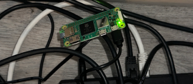
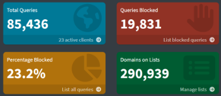

# Pi-hole

## 📸 The Setup & Dashboard

|  Physical Hardware Setup   | Pi-hole Admin Dashboard  |
| :------------------------: | :----------------------: |
| ] |  |

> **Live Metrics:** Successfully blocking **~23%** of all network requests across 19 connected home devices, significantly reducing bandwidth and page load times.

---

## ⚡ Core Features

* **Network-Wide Blocking:** Blocks ads, telemetry, and smart TV trackers natively on every device (iOS, Android, PC, Smart TVs) without installing client-side software.
* **Custom Regex Gravity Lists:** Layered additional adlists targeting mobile telemetry and malicious phishing domains.
* **Local DNS Routing:** Configured custom local DNS records to map home lab services (e.g., `nas.local`, `router.local`) to local static IPs.

---

## Hardware & Tech Stack

* **Hardware:** Raspberry Pi 2W Zero, 32GB MicroSD Card.
* **OS:** Raspberry Pi OS Lite (64-bit).
* **Software:** Pi-hole Core, FTL, and Web Interface.

---

##### Prerequisites
1. Raspberry Pi with a wireless network card for easy setup anywhere.
2. MicroSD card with at least 4 GB
	- The Raspberry Pi OS Lite takes around 2.8 GB
3. A MicroSD or SD card reader
4. Windows, Mac, or Linux computer that has Wi-Fi capabilities
5. Admin access to your router

## Deployment & Installation
1.  **Insert SD**
	- Connect your SD card to your computer and open the [Raspberry Pi Imager](https://www.raspberrypi.com/software/)
2. **Setup**
	- **Device** : Choose your Raspberry Pi device, in my case I'm using the Raspberry Pi Zero 2 W.
	- **OS** : Select Raspberry Pi OS ( other ) then Raspberry Pi OS Lite ( 64-bit )
	- **Storage** : Select the SD card you connected earlier.
	- **Customization** 
		- **Hostname** : pihole.local
		- **Username** : username here
		- **Password** : password here
		- **WLAN ( Wi-FI )** : Enter the information for your Wi-Fi connection. Make sure the name is exact and the password is correct to save yourself some frustration later.
			- Also, make sure to check what Wi-Fi capabilities your Raspberry Pi has ( 2.5 Ghz or 5 Ghz ) and set up the appropriate one.
		- Enable SSH : Very important for remote access. This will use your Username and Password from earlier.
	- Write to the SD card
3. **Startup**
	- Transfer the SD card to the Raspberry Pi and plug the device into a power source.
	- Wait for the green light to stabilize and give it a few more minutes to set up.
4. **Connect**
	- SSH into the device using your computer's terminal.
		- Make sure your computer is on the same Wi-Fi as your Raspberry Pi
		- Then open terminal and use the command `ssh [username]@[hostname].local`
		- Once connected run the installation command `curl -sSL https://install.pi-hole.net | bash` 
	- Assign a static IP to your Raspberry Pi through your router admin portal.
	- Select Cloudflare as your DNS upstream server
	- Optional : Accept StevenBlack's Unified Hosts List
	- Enable query logging
	- Privacy mode : Hiding clients and domains will save some write space on the SD card.
	- Screenshot or save the information on the Installation Complete page as your Admin Webpage login password will be needed.
5. **Access pihole**
	- Since we setup the host as pihole.local, we can head directly into our browser and access the page with pihole.local/admin
	- Use the password provided previously or setup a password while connected to pihole via SSH with `sudo pihole setpassword` 
6. **Setup DNS routing**
	- Go to router admin page and set the DNS to the Raspberry Pi's static IP address.
7. **Blocklists**
	- [This GitHub repo](https://github.com/hagezi/dns-blocklists?tab=readme-ov-file#pro) has a bunch of different block-lists that cater to different needs.
		- I am using [Multi PRO](https://cdn.jsdelivr.net/gh/hagezi/dns-blocklists@latest/adblock/pro.txt) 
	- Go to tools > update gravity > update

---

## 🧠 Lessons Learned & Architectural Choices

* **SSH connectivity issue:** Initially when I set up the Pi, I set the SSID and password for my 5 Ghz Wi-Fi connection. This sent me down the route of checking ipconfig in my terminal and trying to see what ports were open but still not being able to find the pi-hole. Once I put together I needed to be on the same network I realized my mistake. Not only was I trying to connect via SSH through my ethernet port, when i swapped to the 5 Ghz band i realized the Pi might not even have that capability. I had to reinstall the settings for the 2.5 Ghz and everything worked properly afterwards.
* **SD Card Longevity:** Pi-hole frequently writes logs to the SD card, which can degrade it over time. I modified `pihole-FTL.conf` to optimize memory logging and minimize physical disk writes.
